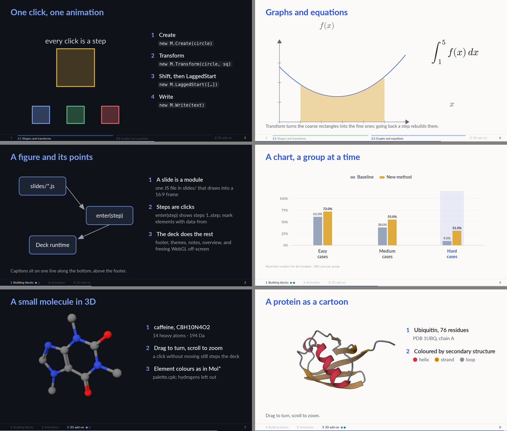

# Live slides template

Slide decks drawn live in the browser: HTML for text, [manim-web](https://github.com/maloyan/manim-web)
for manim-style animations that play **one step per click**, and an optional 3D add-on that draws molecules
and protein cartoons the way Mol* does. No build step and no rendered video — edit a slide, refresh. Decks
work offline, straight from disk, in a dark and a light theme.



## Try it

Open `talks/example/index.html` in Chrome or Firefox (or run `python -m http.server 8000` here and browse to
`http://localhost:8000/talks/example/`). Click or press → to step; ← or right click goes back.

| Key | |
| --- | --- |
| → ← / left, right click | next / previous step |
| S | speaker view (notes, timer, next slide) |
| O | overview |
| F | fullscreen |
| T | light / dark theme (or `?theme=light`) |
| L | laser pointer |

## Make your own talk

```bash
cp -r talks/example talks/my_talk
# edit talks/my_talk/index.html (slide order, sections) and talks/my_talk/slides/*.js
python tools/check_deck.py talks/my_talk      # every slide and step, both themes; pictures in talks/my_talk/check/
```

A slide is one module:

```js
Deck.slide('hello', {
  steps: 2,
  notes: 'what to say',
  mount(frame, { palette: P, M }) {
    frame.innerHTML = `<h2 class="deck-heading reveal-in in">Hello</h2><div class="deck-stage"></div>`;
    const stage = Deck.manim(frame.querySelector('.deck-stage'), {
      build: () => ({ c: new M.Circle({ color: P.accent }), s: new M.Square({ color: P.fg }) }),
      steps: [({ c }) => [new M.Create(c)], ({ c, s }) => [new M.Transform(c, s)]],
    });
    return { enter: stage.go, freeze: stage.freeze, destroy: stage.dispose };
  },
});
```

[AGENTS.md](AGENTS.md) has the full conventions — the slide contract, the design language (type scale, layout
grid, colours, components), the manim-web stage, the 3D add-on, data files and checking. Point your coding
agent at it.

## What's in the box

- `web/deck.js`, `web/deck.css` — runtime and design language: 16:9 frames that scale to any screen, a
  type scale, a section footer with per-topic progress, step reveals, a numbered points column, captions,
  dark/light themes, a laser pointer, and a WebGL budget so many 3D slides don't exhaust the browser.
- `web/manim.js` — `Deck.manim`: write what each click plays; going back rebuilds the scene at that step.
- `web/plots.js` — `Deck.groupedBars`: bar charts that grow a group or a series per click.
- `web/addons/` — `Deck.turntable` (drag/zoom 3D stage), `Deck.molstar` (outlines, ambient occlusion and
  lighting tuned against Mol*), `Deck.cartoon` (protein cartoons built like Mol*'s).
- `tools/prep_protein.py` — any PDB/mmCIF chain → cartoon data. `tools/check_deck.py` — headless check.

## Requirements

A recent Chrome, Edge or Firefox. Python only for the tools: `pip install playwright gemmi numpy` (and
`playwright install chromium`); `mdtraj` optionally, for DSSP on structures without helix/sheet records.

## Credits

Bundled in `vendor/`, each with its licence: [manim-web](https://github.com/maloyan/manim-web) 0.39.4 (MIT),
[Reveal.js](https://revealjs.com) 6.0.1 (MIT), [Lato](https://www.latofonts.com) (SIL OFL). Example data:
ubiquitin, PDB [1UBQ](https://www.rcsb.org/structure/1UBQ); caffeine, an RDKit conformer.
